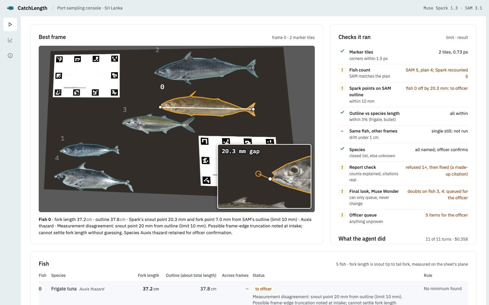
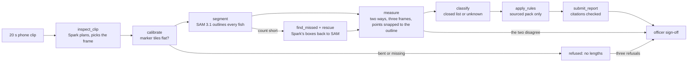

# CatchLength

A verifiable agent for Sri Lanka's port fish sampling. It plans the job, measures every fish in a phone clip, checks each length a second way, hands what it can't settle to a fisheries officer, and leaves an audit trail for every number.

Sri Lanka already measures coastal tuna from photographs. NARA, the national aquatic research agency, presented its photo-board method to the IOTC in 2025 ([IOTC-2025-WPM16-10rev1](https://iotc.org/sites/default/files/documents/2025/10/IOTC-2025-WPM16-10rev1-Sri_Lanka_photo.pdf)): field staff lay fish on a 60 cm board, take a photo, then draw a line on each fish from the snout to the tip of the tail (its total length) in FishMesh-2 and name its species by hand. CatchLength could replace that drawing and naming. It measures fork length, the measure IOTC length-frequency data uses, and checks it against the total length the species' published relationship predicts, so it gives both. You film about 20 seconds of fish laid next to printed marker sheets, and an agent built on Meta's models plans the job, finds every fish, measures each one twice, hands anything it can't settle to a person, and files a length-frequency report that cites the rule behind every check.

Fork length in 1 cm classes is the format this data already travels in. Sri Lanka's port samplers record fork length to the nearest 1 cm into NARA's PELAGOS database for the length-frequency return that IOTC Resolution 15/02 requires ([Dalpathadu 2026, Aquat. Living Resour. 39:8](https://www.alr-journal.org/10.1051/alr/2026002)); IOTC's reporting guidelines recommend 1 cm classes for fork length ([Guidelines for the reporting of fisheries statistics to the IOTC](https://iotc.org/sites/default/files/Guidelines_Data_Reporting_IOTC1.pdf)); and the IOTC Secretariat drops frigate, bullet and kawakawa samples reported in classes wider than 2 cm ([IOTC-2020-WPDCS16-16](https://iotc.org/sites/default/files/documents/2020/11/IOTC-2020-WPDCS16-16_-_Size_data_anomalies.pdf), Table A1).

Built for the Meta Global AI Developer Hackathon (Indie track), theme Build for Your World. All code in this repository was written from 27 October 2026.



## How it checks itself

The checks sit inside the agent's tools, so the model can't skip them.



- Calibration refuses a clip when the marker tiles are missing or bent (corner error over 1.5 px).
- If SAM 3.1 finds fewer fish than Muse Spark expects, Spark returns boxes for the missed or merged fish, and they go back to SAM as box prompts with negative points on the neighbouring fish. A new mask is kept only if its size looks like one fish and it doesn't overlap one already found. (This loop is tested on scripted runs. In our real-model scenes SAM 3.1 separated touching and even overlapping fish on its own, so the rescue never had to fire.)
- Each fish is measured twice: an outline length on the sheet's plane and a snout-to-fork length from Spark's points. If the two disagree, the fish is flagged for the officer.
- Spark's snout and fork points are moved onto the outline SAM drew, and the fork length is measured between the moved points. A point that sat more than 1 cm from the outline on the sheet, inside or outside the fish, means the two models disagree about where the fish ends by more than the 1 cm length classes its report uses (the class IOTC's reporting guidelines recommend for fork length), so the fish is flagged instead of snapped. (Until 3 November the limit was 8 image pixels. On the first real run Spark's points sat 5-8 mm from clean tail forks and snapped onto the right notch, yet every fish was flagged, and a pixel limit means a different distance at every resolution and camera height. The change is in the `freeze-2026-11-03` record.)
- The fish are measured again in two other frames, and a length that moves by more than 1 cm is flagged.
- For species with a published length-length relationship (frigate and bullet tuna, IOTC-2021-WPNT11-14), the outline must be within 3% (a tolerance we chose around that published regression) of the total length that relationship predicts from the fork length, or the fish is flagged.
- No minimum landing size for the tunas and mackerel sampled here was found in the sources we reviewed (Sri Lanka's gazetted fisheries regulations, `data/rules.json`), and the report says "no rule found" for each of them. Rules come only from a pack with a source for each, and model-written text that cites any other rule is refused.
- A tool refused three times hands the job to the officer, and a filed report waits for the officer's sign-off.
- A benchmark compares the agent's lengths with the same fish measured by hand on a measuring board. The agent never sees those numbers.

Every run also gives the seller a size receipt (`web/receipt.html`, sent over WhatsApp or saved as a PDF): each accepted fish's fork length and an estimated weight from a published length-weight curve for its species, with the formula and source printed under it. It's evidence for the sale, with the same lengths the officer files, and it doesn't set a price. Flagged fish show as waiting for the officer, and Indian mackerel gets no weight because we found no sourced fork-length curve for it.

Every run ends with an audit receipt: the clip's hash, the models used, the calibration error, which fish were rescued, the frames checked, how far Spark's points sat from SAM's outlines (median, worst fish, how many over the limit), the cost, the code version and the hash of the CSV. The code version names the freeze tag (`scripts/freeze.py`, made before the field shoot) and says whether the code and thresholds still match it; the thresholds themselves are printed too.

## Meta models

| Model | Job |
|---|---|
| Muse Spark 1.3 | Runs the agent loop (one tool per turn); plans the clip; finds missed and merged fish; places snout and fork points; names the species from a closed list |
| SAM 3.1 | Segments every fish from the concept "fish", then again from Spark's boxes and negative points |
| Muse Wonder 1.0 (optional, `--verify`) | A last look at the filed report. It can only add fish to the officer's queue; it can't change a length, a species or a status. Ran on the recorded scenes: no doubts on the touching scene; two doubts on the five-fish scene (fish 3 and 4: "line extends past the fork notch", "no visible fork"), both queued for the officer. Those outlines read 29.6 and 33.1 cm against true lengths of 30.0 and 33.0 cm, so the doubts were cautious rather than right, which is the direction a bounded verifier should fail in |
| Muse Spark Open on Baseten (optional, `--audit-open`; built, not yet run) | The same bounded check by the open-weights model, hosted separately, as an independent auditor |

## Prior art

Measuring fish from images isn't new. The closest tools we know of:

| Tool | How it works | Published numbers |
|---|---|---|
| FishNet (Mots'oehli et al., IEEE COINS 2024, [arXiv 2403.10916](https://arxiv.org/abs/2403.10916)) | Mask R-CNN and length models trained on 300,000 hand-labelled images (1.2 million fish, 163 species) | 92% IoU on segmentation, 89% top-1 species accuracy on single-fish images, 2.3 cm mean absolute length error, all on its own held-out data |
| MatsyaMetri (ICAR-CMFRI, Kochi, [Sep 2026](https://www.icar.org.in/en/icar-cmfri-kochi-develops-smartphone-app-measure-fish-length-and-width-without-physical-handling)) | Augmented-reality phone app: finds a flat surface and measures length and width, exports CSV; ARCore Android phones only | No accuracy figure published that we could find |
| FishSense Lite (UC San Diego and REEF, [GCFI 77 proceedings](https://proceedings.gcfi.org/wp-content/uploads/2026/02/77-GCFI-PDF-27.pdf)) | Underwater camera (Olympus TG6) with a laser for range, carried by volunteer divers | Thousands of fish of 11 species, 37 volunteers, 230 dives (Aug 2023 to Oct 2024); lengths not statistically different from stereo-video (Kruskal-Wallis p = 0.481, n = 66) |

CatchLength differs in three ways: it isn't trained on fish at all (Meta's models are used as they ship), it needs only printed paper tiles and any phone camera (no AR support, laser or second camera), and each length is checked by a second method and other frames, with the fish handed to a person when the checks disagree. FishNet's numbers come from a much larger dataset of its own, so they can't be compared directly with our field benchmark.

The step it could replace is the line-drawing and species-naming in Sri Lanka's photo-board sampling, presented by NARA to the IOTC (IOTC-2025-WPM16-10).

## Benchmark

Field results from fish tape-measured on 4 November 2026 will be added here. The console's Benchmark tab reads `web/benchmark.json`.

We hold it to NARA's own method. Their photo-board lengths differed from the measuring board by 0.05 cm on average, on 22 frigate tuna whose lengths had a standard deviation of only about 1.3 cm (IOTC-2025-WPM16-10rev1). Random error smears a length-frequency table; bias shifts the whole thing, so the report leads with bias: the mean agent-minus-tape difference on the 10 held-out fish, after a correction fitted only on the other fish. The target, set on 3 November before the shoot, is under 0.5 cm either way. Mean error is reported as a share of fish length (2 cm on a 27 cm tuna is 7%) and as the share of fish within 1 cm. The older pass mark, a mean error of 2.0 cm or less on 40 or more fish, is only the point where we would stop the project.

One bias we expect: the tiles lie on the sheet, but a fish's outline sits a centimetre or two above it, closer to the camera, so lengths can read about 2% long from 1 m (roughly +0.5 cm on a 28 cm fish). The held-out correction is there to measure and remove it.

Declared before the shoot: the ground truth is fork length on a measuring board; 10 fish are measured twice to give the tape's own error; fish tags 4, 8 … 40 are held out, so any bias correction is fitted on the other fish and scored on those 10; and the same 10 fish are timed by hand and with the agent.

How much error the camera and the marker tiles add on their own, before any model is involved: on 112 synthetic fish in 30 scenes degraded like a 1080p phone frame from about 1 m (blur, sensor noise, JPEG), measured from each fish's true outline, the mean length error is 0.16 cm (90th percentile 0.31 cm, worst 0.53 cm). This is a synthetic test of the geometry only (`scripts/geometry_budget.py`); the field benchmark measures the whole agent.

## Stress test on public footage

Before field use we ran it on four frames of real fish from the Florida Fish and Wildlife Conservation Commission's "How to Measure a Fish" ([youtu.be/2Va-ANxdQhM](https://youtu.be/2Va-ANxdQhM), CC BY): a Spanish mackerel and a black sea bass on a measuring board, filmed at an angle and partly under the presenter's hands, with no marker tiles. This tests behaviour, not length: the clip has no tiles for scale and no tape reading we could check against. Script: `scripts/public_check.py`; results: `data/public_check.json` ($0.27).

- With no tiles in view the agent refused to measure on all four frames, filed no lengths and handed each run to the officer.
- SAM 3.1 outlined every real fish in view. It also outlined the fish drawn on a printed species chart lying on the table, finding 14 "fish" in a frame with 2. At a stall, keep posters and printed fish pictures out of the shot.
- Neither fish is on CatchLength's five-species list. Spark called the black sea bass "unknown" (0.97), but called the spotted Spanish mackerel a kawakawa at 0.85-0.88 confidence, a look-alike from the same family. A confident wrong name passes the 0.5 confidence cut, which is why species stays an officer-confirmed field.

## When it goes wrong

| What goes wrong | What the agent does |
|---|---|
| A tile is curled, folded or not on a flat surface | Calibration refuses the clip (corner error over 1.5 px), so no lengths are filed |
| No tile in view, or the light is too poor to find one | Same refusal; three refusals hand the job to the officer |
| Glare on silver skin clips the outline | Spark's points sit off SAM's outline, or the outline disagrees with the fork length: the fish is flagged |
| A frayed or folded tail fork | The fork point lands off the outline, or (for frigate and bullet tuna) the total-length check fails: flagged |
| A bent fish (rigor, a crate) | Outline length and fork length disagree, or the length drifts between frames: flagged |
| Fish touching or overlapping | The count check sends boxes and negative points back to SAM to split them; a split that still looks wrong is flagged |
| A species it doesn't know, or frigate vs bullet tuna it can't tell apart | It reports "unknown" when its confidence is under 0.5, never a guess |
| Too many fish flagged | The receipt and benchmark show the share flagged, so the time saved is shown honestly |

## Run it

```bash
python -m venv .venv && .venv/bin/pip install -r requirements.txt
echo "MODEL_API_KEY=..." > .env          # a Meta Model API key; never commit it
.venv/bin/python -m catchlength.cli path/to/clip.mp4     # writes runs/<clip>/run.json, catch.csv, frame.jpg
.venv/bin/python -m catchlength.server                    # the console at http://127.0.0.1:8000
.venv/bin/python -m pytest -q                             # tests (no key needed)
.venv/bin/python scripts/smoke.py                         # first real call: a Spark ping, then SAM + Spark on known lengths
.venv/bin/python scripts/record_samples.py                # re-record the console's three samples on the real models
.venv/bin/python scripts/record_samples.py --audit-open  # add the open-weights auditor (BASETEN_API_KEY in .env)
```

Print `print/catchlength_A4_tiles.pdf` at 100% and check that each sheet's bar measures 100 mm. Lay at least two tiles flat on the same surface as the fish.

Grade a field day (runs every clip, writes a tags file per clip to fill in from its overlay, then grades). `ground_truth.csv` in the day folder has the header `batch,tag,species,fork_cm,fork_cm_2,total_cm,total_cm_2,notes` (template in `print/ground_truth_template.csv`); when `total_cm` is filled it also writes `web/benchmark_tl.json`. Then `publish_run.py` copies a graded run into `web/samples/` and puts it first in the sample list, so the console opens on it:

```bash
.venv/bin/python scripts/field_day.py data/raw/<day> --manual-s 300 --film-s 90
.venv/bin/python scripts/publish_run.py runs/<clip> --id field-tray1 --label "Real fish, tape-checked"
```

Or grade runs directly:

```bash
.venv/bin/python -m catchlength.audit ground_truth.csv runs/clip1/ runs/clip2/ --out web/benchmark.json
```

## Cost and limits

Estimated at under $0.40 per clip at standard prices (SAM 3.1 is $2.50 per 1,000 images; Muse Spark 1.3 is $1.25 and $4.25 per million input and output tokens). Each run stops at $0.60. The public server runs only preloaded samples, a few per visitor per day, under a daily cap; repeat runs replay cached model responses.

Limits: a closed list of five coastal species (skipjack, kawakawa, Indian mackerel, frigate and bullet tuna), anything else is "unknown"; fish laid flat on a flat surface; daylight; no Sinhala voice input (Muse Voice Transcribe doesn't support Sinhala). The officer's sign-off panel can switch to Sinhala or Tamil; that wording is a draft and still needs a native speaker's check.

## Next steps

- A fixed camera over the landing table. With the tiles fixed to the table once, every tray placed under it is measured with no setup, the same idea as the electronic-monitoring cameras already used on fishing vessels. Nothing here is built yet.
- Read the measuring board NARA's samplers already carry as the scale, so the paper tiles become optional.
- Larger species (yellowfin tuna, seer fish) once there are sourced length relationships for them and a wider frame.

## What was built when

Built during the hackathon (27 October to 4 November 2026): the agent loop, its ten tools and every check (calibration, count, two-way measurement, cross-frame drift, species, the rule pack, the report check); the marker tiles, the synthetic scenes and the geometry test; the console, the officer sign-off, the size receipt and the audit receipt; the tape benchmark and its grader; the stress test on public footage; the tests.

Existed before: the idea and the application text. The museum fish photographs in `data/sources/` are Smithsonian (USNM) specimens, public domain via Wikimedia Commons (each file and its source is listed in `data/sources/sources.txt`); they are used only for tests and the simulated sample, which is labelled wherever it appears. Meta's models are used as they ship, and the length relationships come from the published IOTC papers cited in `config/species.json`.

## Licence

MIT
